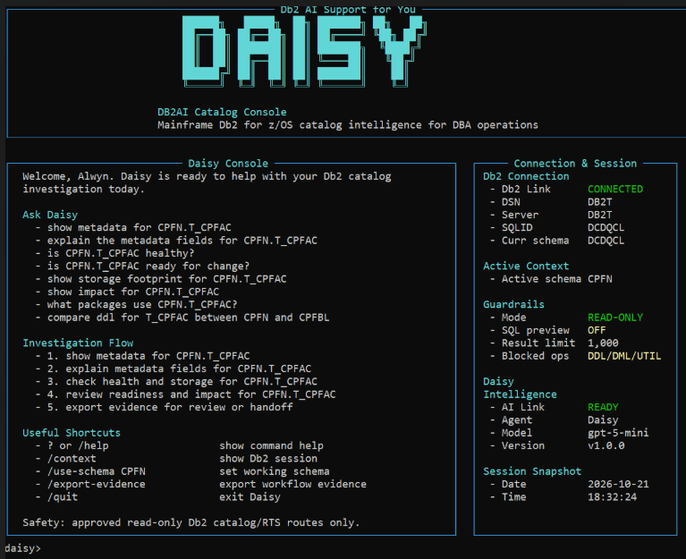
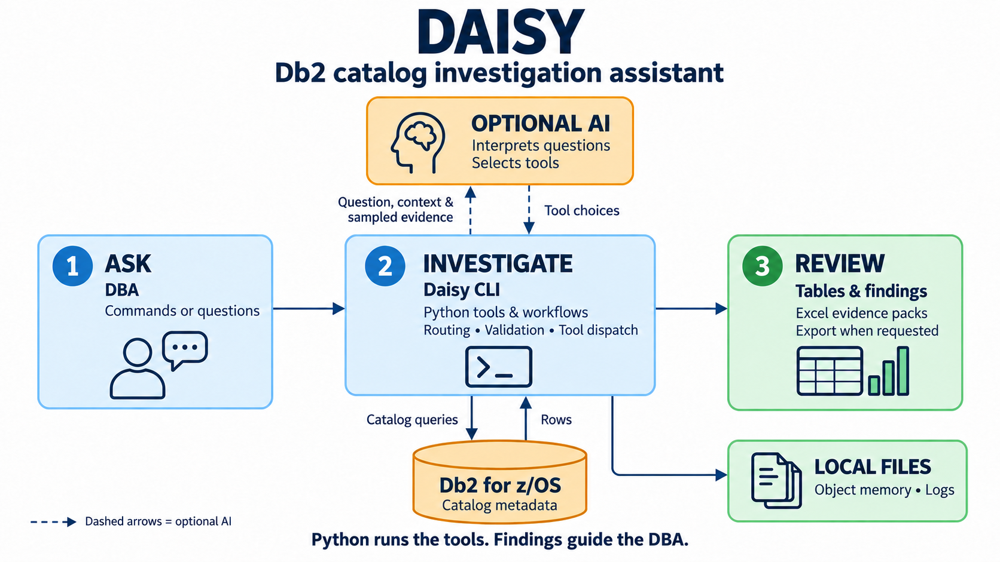
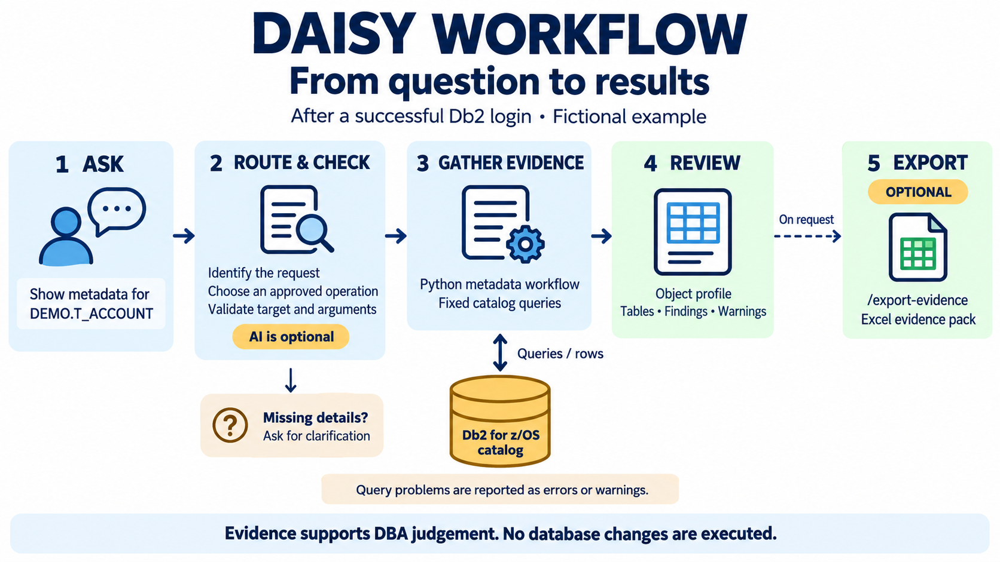

# DAISY — Db2 AI Support for You

**A Db2 for z/OS investigation assistant that brings catalog evidence,
repeatable checks and reviewable findings into one terminal workflow.**

DAISY, also called the **DB2AI Catalog Console**, helps database administrators
understand database objects, investigate dependencies and storage, and prepare
evidence for review. It combines catalog queries that would otherwise need to
be selected, run and interpreted separately.

This self-initiated internal project applies database and production-support
experience to Python automation and controlled AI integration.

**Technologies:** Python · Db2 for z/OS · ODBC connectivity · Optional LLM tool
calling · Excel evidence exports

## The problem DAISY addresses

A question such as “What depends on this table?” can lead to several separate
queries, checks and outputs. Repeating that process takes time, relies on
individual knowledge and makes consistent handovers harder.

DAISY brings those steps together. Predefined tools retrieve metadata,
repeatable workflows organise the investigation, and results retain supporting
evidence and warnings. Optional AI lets a DBA ask questions in natural language;
explicit commands provide direct access to supported operations.

The intended benefits are less query preparation, more consistent checks and
simpler evidence assembly. Time savings and the additional benefit of AI remain
to be measured.

## What DAISY can do

| DBA need | DAISY capability |
| --- | --- |
| Understand an object | Inspect definitions, columns, indexes, constraints and privileges. |
| Assess dependencies | Trace catalog-recorded packages, plans, views, triggers and related objects. |
| Investigate storage and health | Combine tablespace, index and real-time statistics (RTS) evidence into storage summaries and advisory readiness findings. |
| Explain and compare | Explain metadata terms and status codes, interpret pasted DISPLAY output, and compare supported columns, indexes and catalog-derived definitions. |
| Prepare a handover | Present findings with warnings and tool traces, and export investigation evidence to Excel. |

## DAISY console



The console brings together example questions, an investigation flow and command
shortcuts. The side panel shows connection, active-schema and AI status. Session
values reflect the captured example and vary by configuration.

## Architecture at a glance


[Open the full-size overview](assets/DB2AI_Catalog_Console_DAISY_Infographic.png).

The infographic groups the main responsibilities; its numbers are conceptual
labels. Workflows call tools that query Db2, and validation occurs at multiple
points. AI routing is optional.

### How the components work together



[Open the full-size architecture](assets/daisy-architecture-infographic.png).
Dashed arrows show optional AI interactions.

- **The DBA defines the task** through a command or question.
- **AI interprets intent and selects available tools** when enabled.
- **Python validates requests and controls execution**, including predefined SQL,
  investigation steps and calculations.
- **Db2 supplies catalog evidence**, which supports terminal findings and
  optional Excel exports.
- **The DBA reviews the findings** and decides what action is appropriate.

## From question to results



[Open the full-size workflow](assets/daisy-workflow-infographic.png).

After an authorised connection, an investigation of the fictional object
`DEMO.T_ACCOUNT` could look like this:

```text
/metadata DEMO.T_ACCOUNT
/export-evidence
/quit
```

The metadata workflow gathers an object profile and supporting results.
Export saves the retained investigation evidence to Excel on request. Missing
information can lead to clarification; errors and warnings remain part of the
review.

## Scope and operating boundaries

DAISY's exposed operations investigate catalog metadata and interpret supplied
text. They do not execute database changes, utilities, arbitrary SQL or live
DISPLAY commands, or retrieve application business rows. Comparing database
definitions does not execute them.

Findings are advisory. Catalog evidence can be incomplete or stale, and a catalog
dependency list is not a complete application impact assessment. Application
checks must be supported by appropriate database account permissions. With AI
enabled, questions, context and sampled evidence can reach the configured
provider; logs and exports also require appropriate handling.

## Project ownership and validation

I originated the idea, selected the investigation flow, designed the boundary
between AI tool selection and Python-controlled execution, and worked through
the initial Python-to-Db2 connection. AI assisted development, testing, review
and documentation.

Recorded automated checks passed for selected investigation workflows, input
validation, error handling, AI tool controls and Excel exports. These checks
used prepared database results and simulated AI replies. They verify specific
application behaviours; live database compatibility and AI accuracy require
separate evaluation.

Read the [Engineering Notes](engineering-notes.md) for my contribution, design
trade-offs, practical challenges, validation evidence and evaluation priorities.
