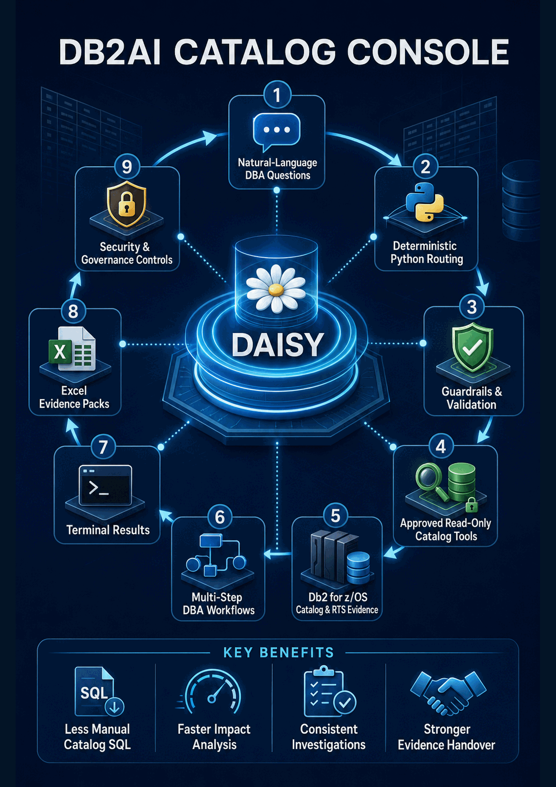

# DB2AI Catalog Console / DAISY

> Governed AI for Db2 for z/OS catalog intelligence

DB2AI Catalog Console is a terminal-first DBA investigation assistant. Its conversational interface, **DAISY (Db2 AI Support for You)**, converts natural-language questions into approved, read-only investigations against Db2 for z/OS catalog and Real-Time Statistics (RTS) evidence.

The design deliberately separates language understanding from execution authority: the LLM may interpret intent and select from advertised capabilities, while deterministic Python controls validation, routing, tool approval, database access, evidence handling and export.

[Download the editable PowerPoint](docs/DB2AI_Catalog_Console_DAISY_Project_Presentation.pptx) · [View the presentation PDF](docs/DB2AI_Catalog_Console_DAISY_Project_Presentation.pdf)

## The problem

Common DBA investigations often require the same manual sequence:

1. Translate an operational question into Db2 catalog concepts.
2. Recall the appropriate `SYSIBM` catalog or RTS sources, columns and joins.
3. issue multiple discovery, dependency, storage, status or recovery queries.
4. Reconcile raw values across related objects.
5. Consolidate the findings into evidence suitable for review and handover.

This repeated process depends heavily on individual catalog knowledge, can lead to inconsistent investigation approaches, and slows database-change impact analysis and evidence preparation.

## The solution

DAISY provides a governed interface for natural-language questions and explicit commands. Each request passes through ordered safety and routing gates before an approved catalog tool or multi-step workflow can run.

At a high level:

1. The user submits a DBA question or supported command.
2. Deterministic pre-routing blocks unsafe intent, resolves local commands and handles known clarification cases.
3. DAISY returns a strict, structured intent route—not executable SQL.
4. Python normalizes and validates the route, identifiers and arguments.
5. Only a tool or workflow in the approved registry can be dispatched.
6. Read-only catalog and RTS queries return typed evidence.
7. Results are rendered in the terminal and can be packaged into an Excel evidence pack.
8. Safe session context and usage logging preserve continuity and traceability.

## Primary capabilities

- Discover and locate schemas, databases, storage groups, tablespaces, objects and columns.
- Profile object metadata and explain Db2 catalog terminology and status values.
- Trace packages, plans, views, triggers, referential integrity, constraints and privileges.
- Assess dependencies and object families during database-change impact analysis.
- Review RTS footprint, partitions, storage, copy history, pending DDL and index readiness.
- Investigate catalog abnormal status and interpret pasted `DISPLAY` output.
- Compare columns, indexes and catalog-derived DDL.
- Compose approved checks into health, readiness, storage and impact-analysis workflows.
- Present findings, warnings, source catalogs and tool traces in terminal and Excel formats.

The inspected project sources expose **67 approved callable tools** and **16 multi-step workflow methods**. The refreshed project documentation describes a **15-module current architecture** and reports **zero syntax failures across its 15-file validation run**.

## Technology stack

| Layer | Technology | Purpose |
|---|---|---|
| Runtime and terminal UI | Python, Rich, `input()` / `prompt_toolkit` | Modular command-line experience and readable evidence rendering |
| Db2 connectivity | ODBC, `pypyodbc` | Controlled read-only access to Db2 for z/OS |
| Validation and models | Pydantic, dataclasses | Strict tool inputs and typed query/workflow results |
| AI orchestration | LangChain, native function calling, strict JSON routing | Natural-language intent selection from an approved capability catalog |
| LLM gateway access | Azure/OpenAI-compatible gateway, `httpx` | Controlled enterprise model access and HTTP handling |
| Deterministic knowledge | Python glossaries and text parsing | Explain metadata and status evidence without database execution |
| Evidence and state | `openpyxl`, JSONL, JSON state | Excel evidence packs, usage audit trail and safe session context |
| Configuration | `.env`, `python-dotenv` | Externalized operational configuration without embedding secrets |

## Security and governance

Safety is enforced through multiple independent boundaries:

- **Prompt boundary:** blocks prompt injection, secret requests, off-topic requests and mutation or administration intent.
- **Route boundary:** accepts only structured routes that can be normalized, clarified, repaired safely or rejected.
- **Tool boundary:** exposes approved tool objects only; arbitrary SQL is not an LLM capability.
- **SQL boundary:** validates read-only `SELECT` operations and blocks prohibited keywords.
- **Data boundary:** limits access to approved Db2 catalog and RTS evidence rather than application data.
- **Output boundary:** controls session memory, logging and evidence-only Excel exports.

The LLM is never authorized to execute raw SQL, DDL, DML, utilities, administration commands, shell commands or Python code, and credentials are not placed in its context.

## Evidence and validation

Query and workflow results preserve:

- result tables and source catalogs;
- findings with severity;
- warnings and conclusions;
- the approved tool trace;
- execution context suitable for operational handover.

The documented validation covers catalog abnormal-status handling, `DISPLAY` glossary and parser behaviour, clarification flows, and safety regression categories. The presentation distinguishes results verified directly in the supplied source listings from current-state claims reported by the refreshed project documents.

## Operational value

- Reduces repeated manual catalog SQL for common DBA investigations.
- Accelerates impact analysis across dependencies and related object families.
- Standardizes investigation workflows, terminology and evidence interpretation.
- Improves review and handover through visible trace, findings and Excel evidence packs.
- Helps less-experienced DBAs use established investigation patterns without granting unrestricted execution.

## Current boundaries

- Catalog and RTS evidence does not replace live `DISPLAY DATABASE` proof.
- Pasted `DISPLAY` parsing is best-effort and benefits from additional real-world samples.
- Application-data access, utility execution and automated remediation are intentionally excluded.
- No quantified time-saved percentage is claimed because the supplied evidence does not establish one.

## Project presentation

The 16-slide presentation provides the complete source-grounded project story, including architecture, startup sequence, request routing, the LLM/Python responsibility boundary, security controls, capability groups, workflow orchestration, evidence generation, validation results, operational impact and roadmap.

- [Editable PowerPoint presentation](docs/DB2AI_Catalog_Console_DAISY_Project_Presentation.pptx)
- [Presentation PDF](docs/DB2AI_Catalog_Console_DAISY_Project_Presentation.pdf)

> This public repository is a sanitized project-documentation showcase. Internal source code, credentials, endpoints, infrastructure identifiers and environment-specific configuration are not included.
